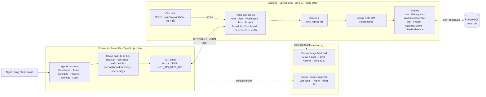

# Sơ đồ kiến trúc Tama

Sơ đồ dưới đây phản ánh mã nguồn và cấu hình triển khai hiện có. Frontend và backend được build thành hai image riêng; PostgreSQL được cấu hình qua biến môi trường. Repository hiện chưa có tệp Compose hoặc migration riêng.

## Các miền chức năng

| Miền | Controller / service | Dữ liệu chính |
|---|---|---|
| Đăng nhập và người dùng | `AuthController`, `UserController` / `AuthService`, `UserService` | `User` |
| Không gian làm việc | `WorkspaceController` / `WorkspaceService` | `Workspace`, `WorkspaceMember`, `WorkspaceRole` |
| Công việc và dự án | `TaskController`, `ProjectController` / `TaskService`, `ProjectService` | `Task`, `Project` |
| Lịch và tổng quan | `CalendarEventController`, `DashboardController` / `CalendarEventService`, `DashboardService` | `CalendarEvent`, `Task` |
| Tùy chọn | `UserPreferenceController` / `UserPreferenceService` | `UserPreference` |

Frontend gọi API qua `frontend/src/api/client.ts`; URL mặc định là `http://localhost:8080/api` và có thể đổi bằng `VITE_API_BASE_URL`. Backend đọc kết nối PostgreSQL từ `DB_URL`, `DB_USERNAME`, `DB_PASSWORD`; mặc định URL cơ sở dữ liệu là `jdbc:postgresql://localhost:5432/tama_db`.
